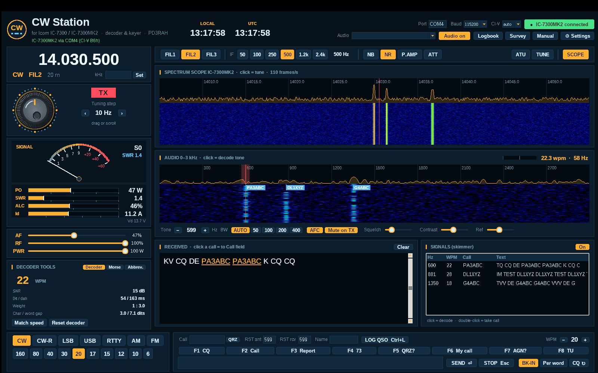

# CW Station for the Icom IC-7300 and IC-7300MK2

**English** · [Nederlands](#nederlands)

A free Windows program for CW (Morse) on the Icom IC-7300 and IC-7300MK2: it decodes CW from the radio's
USB audio, lets you send from the keyboard, and shows the radio's own spectrum scope as a
waterfall, like an SDR panadapter.


*Screenshot with simulated signals.*

## Features

- **CW decoder**: two-stage linear-phase FIR filters with automatic bandwidth (AUTO
  follows the sending speed). Adaptive timing learns the lengths of dits, dahs, and the
  gaps between elements, letters and words, so it also copies Farnsworth, bug and
  hand-key sending. Short key clicks are folded back into the gap.
- **Skimmer**: decodes up to 8 signals in the audio passband at the same time and shows
  their callsigns in the waterfall. Click a signal to decode it in the main window.
- **Keyboard keyer**: sends via CI-V (no extra interface), with F1–F8 macros, prosigns
  (`<AR> <SK> <KN> <BT>`), word-by-word sending, and CQ repeat.
- **Panadapter**: the IC-7300's own spectrum scope over CI-V. Click a signal to tune to it.
- **Radio control**: tuning knob, band and mode buttons, FIL1–3, IF width, NB, NR,
  P.AMP, ATT, ATU and TUNE, AF/RF gain and TX power.
- **Meters**: S-meter, plus digital TX meters for power (W), SWR, ALC and drain current
  with peak hold, and the supply voltage.
- **Automatic radio detection**: IC-7300 (CI-V 94h) or IC-7300MK2 (CI-V B6h).
- **Logbook**: log a QSO with Ctrl+L and export it as ADIF. Click a callsign in the
  received text to take it over, and look it up on QRZ.com with one click.
- English and Dutch interface, and 6 colour themes. Language and theme switch instantly.
- **Decoder tools**: live speed/SNR/weight, Match speed, Morse table and CW abbreviations.
- **Update notification** when a new release is available on GitHub.
- **Survey** button: tell the author what works and what does not (Dutch/English web form).

**Manual:** [English](docs/MANUAL.md) · [Nederlands](docs/HANDLEIDING.md). The manual is
also included in the installer; open it with the **Manual** button.

## Installation

1. Download `CWStation-Setup-x.y.z.exe` from
   [Releases](../../releases) and run it. It needs no admin rights, and Python is included.
2. Windows: *Settings → Privacy & security → Microphone →* turn on **"Let desktop apps
   access your microphone"**. The IC-7300 USB audio counts as a microphone.
3. On the first start, enter your callsign under **Settings**.

> The installer is not code-signed, so Windows SmartScreen may warn you. Click
> *More info → Run anyway*.

Running from source instead: `pip install -r requirements.txt` and then `python src/ic7300_cw.py`
(Python 3.10+ with tkinter).

## Radio settings

IC-7300, MENU → SET → Connectors → CI-V:

| Setting | Value |
|---|---|
| CI-V USB Port | **Unlink from [REMOTE]** (needed for scope data) |
| CI-V USB Baud Rate | **115200** |
| CI-V Transceive | ON |
| CI-V Address | 94h (default) |

IC-7300MK2: CI-V address B6h (default), and use COM port **A (CI-V)**. MK2 support is based
on Icom's documentation and has not yet been tested on a real MK2; feedback is welcome.

USB SEND and USB Keying (CW) are not needed. CW Station opens the COM port with DTR and RTS
low, so the radio will not key up when the program connects.

## Survey page

`web/cwstation/enquete.php` is a self-contained PHP page (Dutch/English) that e-mails the
answers. Nothing is stored on the server. Upload it to
`https://www.pd3rah.nl/cwstation/enquete.php` and set `$MAIL_TO` and `$MAIL_FROM` at the top.
It has a honeypot field, a minimum fill-in time and a per-visitor wait, which keep most
spam out.

## Building the installer

The installer is built on Linux (or by GitHub Actions on every `v*` tag):

```
sudo apt install nsis
pip install zstandard
python3 installer/build_installer.py
```

The script assembles a trimmed Windows Python 3.12 runtime from pinned conda-forge
packages and PyPI wheels, then packs it with NSIS into `dist/`.

## License

MIT, © 2026 Richard A. Hendriksen (PD3RAH). See [LICENSE](LICENSE). The licenses of the
components bundled in the installer are listed in
[THIRD_PARTY_NOTICES.md](THIRD_PARTY_NOTICES.md).

*Not affiliated with Icom Inc. "Icom", "IC-7300" and "IC-7300MK2" are trademarks of Icom Inc. and are
used only to describe compatibility.*

---

<a name="nederlands"></a>
# Nederlands

Een gratis Windows-programma voor CW (morse) met de Icom IC-7300 en IC-7300MK2. Het decodeert CW uit de
USB-audio van de radio, laat je zenden vanaf het toetsenbord en toont de eigen
spectrumscope van de radio als waterval, net als een SDR-panadapter.

## Functies

- **CW-decoder**: tweetraps FIR-filters met automatische bandbreedte (AUTO volgt de
  seinsnelheid). De adaptieve timing leert de lengte van punten, strepen en de spaties
  tussen elementen, letters en woorden. Daardoor leest hij ook Farnsworth, bug en
  handsleutel. Korte keyclicks worden teruggevouwen in de spatie.
- **Skimmer**: decodeert tot 8 signalen tegelijk in de audiodoorlaat en toont hun call in
  de waterval. Klik op een signaal om het in het hoofdvenster te decoderen.
- **Toetsenbord-keyer**: zendt via CI-V (geen extra interface), met macro's onder F1–F8,
  prosigns, woord-voor-woord zenden en CQ-herhaling.
- **Panadapter**: de spectrumscope van de IC-7300 zelf, via CI-V. Klik op een signaal om
  erop af te stemmen.
- **Bediening van de radio**: afstemknop, band- en modeknoppen, FIL1–3, IF-breedte, NB,
  NR, P.AMP, ATT, ATU en TUNE, AF/RF en zendvermogen.
- **Meters**: S-meter, plus digitale zendmeters voor vermogen (W), SWR, ALC en stroom met
  piekwaarde, en de voedingsspanning.
- **Herkent de radio automatisch**: IC-7300 (CI-V 94h) of IC-7300MK2 (CI-V B6h).
- **Logboek**: log een QSO met Ctrl+L en exporteer het als ADIF. Klik op een call in de
  ontvangen tekst om hem over te nemen, en zoek hem met één klik op bij QRZ.com.
- Nederlandse en Engelse interface en 6 kleurthema's. Taal en thema wisselen direct.
- **Decoder-hulp**: snelheid, signaal-ruis en verhouding live, Neem snelheid over, morsetabel en CW-afkortingen.
- **Updatemelding** als er een nieuwe versie op GitHub staat.
- Knop **Enquête**: laat weten wat goed werkt en wat beter kan (webformulier, NL/EN).

**Handleiding:** [Nederlands](docs/HANDLEIDING.md) · [English](docs/MANUAL.md). De
handleiding zit ook in de installer; open hem met de knop **Handleiding**.

## Installatie

1. Download `CWStation-Setup-x.y.z.exe` bij [Releases](../../releases) en start het
   bestand. Er zijn geen beheerdersrechten nodig en Python zit erbij.
2. Windows: *Instellingen → Privacy en beveiliging → Microfoon →* zet **"Desktop-apps
   toegang geven tot je microfoon"** aan.
3. Vul bij de eerste start je call in onder **Instellingen**.

Zie de tabel hierboven voor de CI-V-instellingen van de IC-7300. Je instellingen en je
logboek staan in `%APPDATA%\CWStation` en blijven bewaard als je het programma verwijdert
of bijwerkt.

## Licentie

MIT, © 2026 Richard A. Hendriksen (PD3RAH). Niet gelieerd aan Icom Inc.
