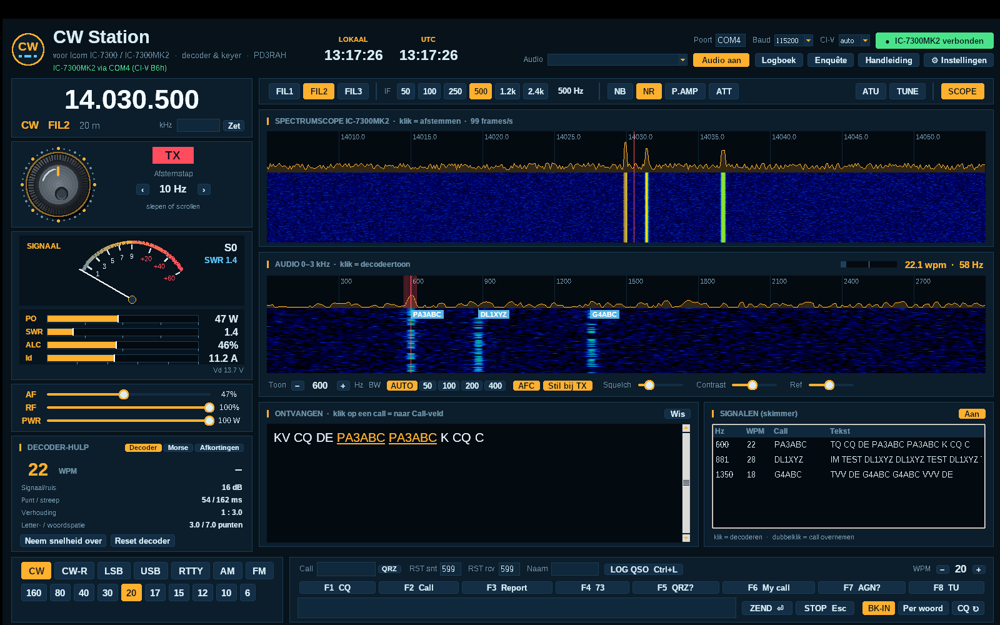

# CW Station – Handleiding

*Versie 2.3 · voor de Icom IC-7300 en IC-7300MK2 · © 2026 Richard A. Hendriksen (PD3RAH)*

CW Station is een gratis Windows-programma voor morse (CW) met je Icom IC-7300 of IC-7300MK2. Het programma:

- **decodeert** CW uit de USB-audio van de radio, ook meerdere stations tegelijk;
- **zendt** CW vanaf je toetsenbord via de USB-kabel, zonder extra interface;
- toont de **spectrumscope** van de radio als waterval, net als een SDR;
- **bedient** de radio: frequentie, mode, filters, vermogen en tuner;
- toont een **S-meter** en digitale **zendmeters** (vermogen, SWR, ALC, stroom);
- houdt een **logboek** bij met ADIF-export.

---

## Inhoud

1. [Wat heb je nodig](#1-wat-heb-je-nodig)
2. [Installeren](#2-installeren)
3. [De radio instellen](#3-de-radio-instellen)
4. [De eerste keer starten](#4-de-eerste-keer-starten)
5. [Het scherm](#5-het-scherm)
6. [Afstemmen](#6-afstemmen)
7. [CW ontvangen](#7-cw-ontvangen)
8. [CW zenden](#8-cw-zenden)
9. [Meters, vermogen en tuner](#9-meters-vermogen-en-tuner)
10. [Filters en ontvangst](#10-filters-en-ontvangst)
11. [Logboek](#11-logboek)
12. [Instellingen en macro's](#12-instellingen-en-macros)
13. [Sneltoetsen](#13-sneltoetsen)
14. [Problemen oplossen](#14-problemen-oplossen)
15. [Bestanden, bijwerken en verwijderen](#15-bestanden-bijwerken-en-verwijderen)

---

## 1. Wat heb je nodig

- Een pc met **Windows 10 of 11**.
- Een **Icom IC-7300** of **IC-7300MK2**.
- Een **USB-kabel** tussen radio en pc: USB-B bij de IC-7300, USB-C bij de MK2.
- De **USB-driver van Icom**, te downloaden van de Icom-website. Windows 11 installeert die vaak zelf.

Python of andere software heb je niet nodig; alles zit in de installer.

## 2. Installeren

1. Download **CWStation-Setup-x.y.z.exe** bij *Releases* op GitHub en start het bestand.
2. Ziet je een blauw scherm *"Windows heeft uw pc beveiligd"*? Klik dan op **Meer info → Toch uitvoeren**. Dit komt doordat het programma niet digitaal ondertekend is.
3. Kies je taal en klik door de installatie. Beheerdersrechten zijn niet nodig.
4. Laat op het laatste scherm het vinkje **"Microfoon-privacyinstelling openen"** aan en zet daar **"Desktop-apps toegang geven tot je microfoon"** aan.
   Windows ziet de USB-audio van de radio als microfoon. Zonder deze instelling krijgt CW Station geen geluid binnen.

Er komt een snelkoppeling **CW Station** op je bureaublad en in het Startmenu.

## 3. De radio instellen

### IC-7300

Ga naar **MENU → SET → Connectors → CI-V**:

| Instelling | Waarde |
|---|---|
| CI-V Address | 94h (standaard) |
| CI-V Transceive | ON |
| CI-V USB Port | **Unlink from [REMOTE]** |
| CI-V USB Baud Rate | **115200** |
| CI-V USB Echo Back | OFF |

### IC-7300MK2

Ga naar **MENU → SET → Connectors → CI-V**:

| Instelling | Waarde |
|---|---|
| CI-V Address | B6h (standaard) |
| CI-V Transceive | ON |
| CI-V USB (A) Echo Back | OFF |

De MK2 heeft twee COM-poorten. Kies in CW Station de poort die Windows **"IC-7300MK2 Serial Port A (CI-V)"** noemt; Apparaatbeheer laat zien welk nummer dat is.

> Ondersteuning voor de MK2 is gebouwd op de documentatie van Icom en nog niet met een echte MK2 getest. Laat je via de knop **Enquête** weten of het werkt?

### Voor beide modellen

- **USB SEND** en **USB Keying (CW)** mogen **OFF** blijven. CW Station zendt via CI-V.
- **ACC/USB AF Output Level** rond **50 %** is een goed begin.
- Zet de **scope** op het scherm van de radio aan (knop M.SCOPE). Alleen dan stuurt de radio scope-gegevens naar de pc.

## 4. De eerste keer starten

1. Start **CW Station**. Het venster **Instellingen** opent vanzelf.
2. Vul je **call**, **naam** en **QTH** in, kies **taal** en **kleur**, en klik op **Opslaan**.
3. Kies rechtsboven de **Poort**, bijvoorbeeld COM4. Laat **Baud** op 115200 en **CI-V** op **auto** staan.
4. Klik op **● Verbind radio**. Het programma zoekt de radio op 94h en B6h. Wordt de knop groen met *"IC-7300 verbonden"* of *"IC-7300MK2 verbonden"*, dan is de verbinding gelukt.
5. Kies bij **Audio** het apparaat **USB Audio CODEC** en klik op **Start audio**.

Het programma onthoudt deze keuzes voor de volgende keer.

## 5. Het scherm

| Deel | Wat het doet |
|---|---|
| **Kopbalk** | Klokken (lokaal en UTC), verbinding, audio, logboek, enquête, handleiding en instellingen |
| **Frequentie** | De VFO-frequentie, mode, filter en band. Typ een frequentie in kHz en klik op **Zet** |
| **Afstemknop** | Afstemmen met slepen of scrollen. Ernaast staan het RX/TX-lampje en de stapgrootte |
| **S-meter en zendmeters** | Signaalsterkte; tijdens zenden ook PO, SWR, ALC, Id en Vd |
| **AF / RF / PWR** | Volume, RF-gain en zendvermogen van de radio |
| **Decoder-hulp** | Snelheid en kwaliteit van het ontvangen signaal, een morsetabel en CW-afkortingen |
| **Functiebalk** | FIL1–3, IF-breedte, NB, NR, P.AMP, ATT, ATU, TUNE en SCOPE |
| **Spectrumscope** | De scope van de radio als spectrum en waterval |
| **Audio-waterval** | De audio uit de radio (0–3 kHz) met decoderinstellingen |
| **Ontvangen** | Gedecodeerde tekst. Je eigen verzonden tekst staat er in een andere kleur |
| **Signalen (skimmer)** | Alle CW-stations in de audio, met call, snelheid en tekst |
| **Onderbalk** | Mode- en bandknoppen, QSO-gegevens, macro's en het zendveld |

## 6. Afstemmen

- **Afstemknop**: sleep met de muis rond de knop, of gebruik het scrollwiel. Met de knoppen **‹ ›** kies je de stap, van 10 Hz tot 5 kHz.
- **Scrollen op de frequentie** werkt ook.
- **Bandknoppen** (160 t/m 6 m) springen naar het CW-deel van die band.
- **Klik in de spectrumscope** op een signaal. De radio stemt erop af en het signaal klinkt op je CW-toonhoogte (pitch).

## 7. CW ontvangen

1. Stem af op een CW-signaal.
2. **Klik in de audio-waterval** op het spoor van het signaal. De rode lijn is de **decodeertoon**.
3. De tekst verschijnt in **Ontvangen**. Rechtsboven in het audiopaneel zie je de gemeten **WPM** en de filterbreedte.

**Instellingen van de decoder:**

| Knop | Uitleg |
|---|---|
| **Toon − / +** | Decodeertoon in stappen van 10 Hz verschuiven |
| **BW AUTO** | De decoder kiest zelf de beste filterbreedte bij de seinsnelheid. Dit is de aanrader |
| **BW 50–400** | Een vaste filterbreedte. Smaller geeft minder storing, maar werkt minder goed bij hoge snelheid |
| **AFC** | Volgt een signaal dat iets verloopt (binnen ±50 Hz) |
| **Stil bij TX** | De decoder luistert niet terwijl je zelf zendt |
| **Squelch** | Hoger zetten geeft minder tekens uit ruis; lager zetten helpt bij zwakke signalen |
| **Contrast / Ref** | Alleen de weergave van de waterval |

**Skimmer.** Het paneel *Signalen* decodeert tot 8 stations tegelijk. De call staat ook als label in de waterval.

- Klik op een regel: het hoofdvenster gaat dat station decoderen.
- Dubbelklik op een regel: de call komt in het veld **Call**.

**Decoder-hulp** (linksonder) heeft drie tabbladen:

- **Decoder** toont de gemeten **snelheid** (groot), de **signaal-ruisverhouding**, de lengte van punt en streep, de **verhouding** daartussen (normaal 1 : 3) en de letter- en woordspatie. Rechtsboven zie je live het teken dat binnenkomt (bijvoorbeeld `–·–·`).
  - **Neem snelheid over** zet je eigen seinsnelheid gelijk aan die van het tegenstation.
  - **Reset decoder** laat de decoder opnieuw beginnen, bijvoorbeeld als je naar een station met een heel andere snelheid gaat.
- **Morse** is een tabel met alle letters, cijfers, leestekens en prosigns.
- **Afkortingen** is een lijst met de meest gebruikte CW-afkortingen en Q-codes, met hun betekenis.

**Calls overnemen.** Calls in de ontvangen tekst zijn onderstreept. Klik erop en de call staat in het veld **Call**. Met **QRZ** open je de QRZ.com-pagina van dat station.

## 8. CW zenden

> Zend alleen op frequenties en banden waarvoor je machtiging geldig is. Luister eerst of de frequentie vrij is.

- **Typ** je tekst in het zendveld onderaan en druk op **Enter**.
- **Per woord**: elk woord gaat direct de lucht in zodra je op de spatiebalk drukt.
- **Macro's F1–F8**: druk op de F-toets of klik op de knop. F1 is je CQ-roep.
- **CQ ↻**: staat deze aan, dan herhaalt F1 zichzelf na een pauze. De duur van de pauze stel je in bij Instellingen.
- **STOP / Esc**: stopt het zenden direct.
- **WPM − / +**: stelt de seinsnelheid van de keyer in de radio in.
- **BK-IN**: zet semi break-in aan. Dat is nodig om via CI-V te kunnen zenden.

**Prosigns:** typ `<AR>`, `<SK>`, `<KN>` of `<BT>`; de letters worden dan zonder tussenruimte geseind.

**Testen of je signaal goed uitkomt:** roep een minuut CQ met F1 en kijk daarna op **reversebeacon.net** of je call gemeld wordt.

## 9. Meters, vermogen en tuner

- **S-meter**: de signaalsterkte die de radio meet.
- **Zendmeters** (alleen tijdens zenden). Het witte streepje is de piekwaarde.

  | Meter | Betekenis | Goed |
  |---|---|---|
  | **PO** | Uitgangsvermogen in watt | wat je hebt ingesteld |
  | **SWR** | Staandegolfverhouding | onder 1,5; oranje vanaf 1,5, rood vanaf 2,0 |
  | **ALC** | Automatische niveauregeling | bij CW meestal laag |
  | **Id** | Stroom van de eindtrap | bij 100 W ongeveer 15–20 A |
  | **Vd** | Voedingsspanning, ook tijdens ontvangen | ongeveer 13,8 V |

- **PWR**: stelt het zendvermogen in (0–100 W).
- **ATU**: zet de ingebouwde antennetuner aan of uit.
- **TUNE**: laat de tuner afstemmen. **Let op:** de radio zendt dan even een draaggolf. Gebruik een vrije frequentie.

De meterwaarden zijn een benadering, omgerekend volgens de tabellen van Icom.

## 10. Filters en ontvangst

| Knop | Uitleg |
|---|---|
| **FIL1 / FIL2 / FIL3** | Kiest het filter van de radio |
| **IF 50 … 2.4k** | Stelt de breedte van het actieve filter in (in CW, SSB en RTTY) |
| **NB / NR** | Ruisonderdrukking van de radio |
| **P.AMP** | Voorversterker: uit, 1 of 2 |
| **ATT** | Verzwakker van 20 dB |
| **SCOPE** | Zet het ophalen van scope-gegevens aan of uit |

**Tip voor de skimmer:** gebruik een breed filter (IF 2.4k). Dan staan er meer stations tegelijk in de audio.

## 11. Logboek

1. Vul onderaan in: **Call**, **RST snt** (gegeven), **RST rcv** (ontvangen) en eventueel de **Naam**.
2. Klik op **LOG QSO** of druk op **Ctrl+L**. Datum, tijd (UTC), band en frequentie worden automatisch toegevoegd.
3. Met de knop **Logboek** in de kopbalk zie je alle QSO's. Met **Exporteer ADIF…** maak je een bestand voor je logprogramma, LoTW of eQSL.

## 12. Instellingen en macro's

Open **⚙ Instellingen**:

- **Taal** (Nederlands/English) en **Kleur**: worden direct toegepast.
- **Mijn call, Mijn naam, Mijn QTH**: worden gebruikt in de macro's.
- **CQ-herhaling**: de pauze in seconden tussen twee CQ-roepen.
- **Macro's**: per F-toets een korte naam en een tekst. Je kunt deze variabelen gebruiken:

| Variabele | Wordt |
|---|---|
| `{MYCALL}` | jouw call |
| `{MYNAME}` / `{MYQTH}` | jouw naam / QTH |
| `{CALL}` | de call in het veld Call |
| `{NAME}` | de naam in het veld Naam |
| `{RST}` | het gegeven rapport |

## 13. Sneltoetsen

| Toets | Functie |
|---|---|
| **F1 … F8** | Macro zenden |
| **Enter** | Tekst in het zendveld zenden |
| **Esc** | Zenden stoppen |
| **Ctrl+L** | QSO loggen |
| **Scrollwiel** op knop of frequentie | Afstemmen |

## 14. Problemen oplossen

| Probleem | Oplossing |
|---|---|
| *"Kan COM4 niet openen"* | Ander programma sluiten dat de poort gebruikt (WSJT-X, logprogramma); juiste poort kiezen in Apparaatbeheer |
| *"geen antwoord van de radio"* | Baud 115200; CI-V-adres op auto; bij de MK2 poort **A** kiezen; radio aan? |
| Radio zendt meteen bij verbinden | USB SEND en USB Keying (CW) op **OFF** zetten in het menu van de radio |
| Scope blijft zwart | IC-7300: *CI-V USB Port = Unlink*, 115200 baud. Beide modellen: scope aan op de radio |
| Geen audio of lege waterval | Microfoontoegang in Windows aanzetten; **USB Audio CODEC** kiezen; *ACC/USB AF Output Level* hoger zetten |
| Melding *"Audio: geen geluid ontvangen"* | Windows blokkeert de geluidskaart of de radio stuurt geen audio. Klik op de melding om de microfoon-instellingen van Windows te openen en zet de toegang voor desktop-apps aan |
| Decoder geeft veel E, T en I | Squelch hoger zetten; precies op het signaal klikken; BW AUTO gebruiken |
| Decoder mist zwakke signalen | Squelch lager zetten; IF-filter smaller zetten (250 of 500) |
| Zenden doet niets | Mode moet CW zijn; BK-IN aan; je call ingevuld bij Instellingen |
| Melding *"NG"* | De radio weigert een commando, bijvoorbeeld IF-breedte in AM of FM |
| Programma start niet | Bekijk `%APPDATA%\CWStation\error.log` en stuur het mee via de enquête |

## 15. Bestanden, bijwerken en verwijderen

- **Instellingen en logboek**: `%APPDATA%\CWStation\` (`settings.json` en `logbook.adi`). Deze blijven bewaard bij bijwerken en verwijderen.
- **Bijwerken**: bij het starten kijkt CW Station of er een nieuwe versie is. Is die er, dan verschijnt een melding en de knop **⬆ Nieuwe versie** in de kopbalk; die opent de downloadpagina. Start daar de nieuwe **Setup** of de kleine **Update** over de oude versie heen. Het controleren zet je uit bij Instellingen.
- **Fouten**: interne fouten worden opgeslagen in `%APPDATA%\CWStation\error.log`. Stuur dat bestand mee als je een probleem meldt.
- **Verwijderen**: via *Windows Instellingen → Apps → CW Station*.
- **Enquête**: met de knop **Enquête** laat je weten wat goed werkt en wat beter kan. Je antwoorden gaan rechtstreeks naar de maker.

---

*CW Station is vrije software onder de MIT-licentie. Het programma is niet gelieerd aan Icom Inc.; "Icom", "IC-7300" en "IC-7300MK2" zijn merknamen van Icom Inc.*
