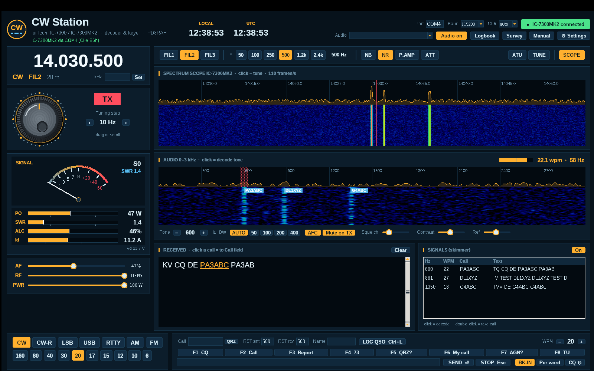
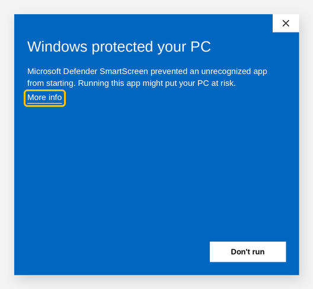
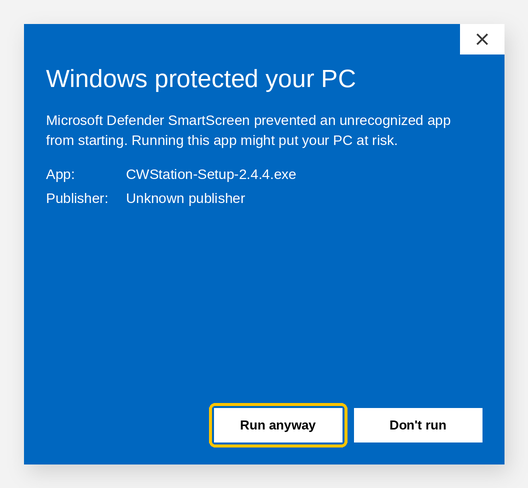

# CW Station – User Manual

*Version 2.4.4 · for the Icom IC-7300 and IC-7300MK2 · © 2026 Richard A. Hendriksen (PD3RAH)*

CW Station is a free Windows program for Morse code (CW) with your Icom IC-7300 or IC-7300MK2. It:

- **decodes** CW from the radio's USB audio, including several stations at once;
- **sends** CW from your keyboard over the USB cable, with no extra interface;
- shows the radio's **spectrum scope** as a waterfall, like an SDR;
- **controls** the radio: frequency, mode, filters, power and tuner;
- shows an **S-meter** and digital **TX meters** (power, SWR, ALC, current);
- keeps a **logbook** with ADIF export.

---

## Contents

1. [What you need](#1-what-you-need)
2. [Installation](#2-installation)
3. [Radio settings](#3-radio-settings)
4. [First start](#4-first-start)
5. [The screen](#5-the-screen)
6. [Tuning](#6-tuning)
7. [Receiving CW](#7-receiving-cw)
8. [Sending CW](#8-sending-cw)
9. [Meters, power and tuner](#9-meters-power-and-tuner)
10. [Filters and reception](#10-filters-and-reception)
11. [Logbook](#11-logbook)
12. [Settings and macros](#12-settings-and-macros)
13. [Keyboard shortcuts](#13-keyboard-shortcuts)
14. [Troubleshooting](#14-troubleshooting)
15. [Files, updating and uninstalling](#15-files-updating-and-uninstalling)
16. [Disclaimer](#16-disclaimer)

---

## 1. What you need

- A PC with **Windows 10 or 11**.
- An **Icom IC-7300** or **IC-7300MK2**.
- A **USB cable** between radio and PC: USB-B on the IC-7300, USB-C on the MK2.
- The **Icom USB driver**, available from the Icom website. Windows 11 often installs it automatically.

You do not need Python or any other software; everything is included in the installer.

## 2. Installation

1. Download **CWStation-Setup-x.y.z.exe** from *Releases* on GitHub and run it.
2. If you see a blue **"Windows protected your PC"** screen, read the box below.
3. Choose your language, read and **accept the disclaimer**, and click through the installer. No administrator rights are needed.
4. On the last page, leave **"Open microphone privacy settings"** ticked and turn on **"Let desktop apps access your microphone"**.
   Windows treats the radio's USB audio as a microphone. Without this setting, CW Station receives no audio.

A **CW Station** shortcut is added to your desktop and the Start menu.

### "Windows protected your PC" message (Windows SmartScreen)

When you start the installer or an update, Windows often shows this message:

1. Click **More info**.
2. A **Run anyway** button now appears. Click it.

**Why does this appear?** CW Station is free hobby software without a (paid) code-signing certificate. Windows therefore does not recognise the program, and the publisher is shown as *"Unknown publisher"*. The message does not mean that it contains a virus. Only download the installer from the official place: the *Releases* page at **github.com/PD3RAH/cw-station**.

An antivirus program may also block the file or move it to quarantine. Restore it from quarantine, or add the folder `%LOCALAPPDATA%\CWStation` to the exclusions.

## 3. Radio settings

### IC-7300

Go to **MENU → SET → Connectors → CI-V**:

| Setting | Value |
|---|---|
| CI-V Address | 94h (default) |
| CI-V Transceive | ON |
| CI-V USB Port | **Unlink from [REMOTE]** |
| CI-V USB Baud Rate | **115200** |
| CI-V USB Echo Back | OFF |

### IC-7300MK2

Go to **MENU → SET → Connectors → CI-V**:

| Setting | Value |
|---|---|
| CI-V Address | B6h (default) |
| CI-V Transceive | ON |
| CI-V USB (A) Echo Back | OFF |

The MK2 has two COM ports. In CW Station, choose the port that Windows calls **"IC-7300MK2 Serial Port A (CI-V)"**; Device Manager shows its number.

> MK2 support is based on Icom's documentation and has not yet been tested on a real MK2. Please use the **Survey** button to tell us whether it works.

### Both models

- **USB SEND** and **USB Keying (CW)** can stay **OFF**. CW Station sends through CI-V.
- **ACC/USB AF Output Level** around **50 %** is a good start.
- Turn the **scope** on at the radio (M.SCOPE button). The radio only sends scope data to the PC while the scope is on.

## 4. First start

1. Start **CW Station**. The **Settings** window opens automatically.
2. Enter your **callsign**, **name** and **QTH**, choose a **language** and **colour**, and click **Save**.
3. At the top right, choose the **Port**, for example COM4. Leave **Baud** at 115200 and **CI-V** at **auto**.
4. Click **● Connect radio**. The program looks for the radio at 94h and B6h. When the button turns green with *"IC-7300 connected"* or *"IC-7300MK2 connected"*, the connection works.
5. Under **Audio**, choose **USB Audio CODEC** and click **Start audio**.

The program remembers these choices for next time.

## 5. The screen

| Area | What it does |
|---|---|
| **Header** | Clocks (local and UTC), connection, audio, logbook, survey, manual and settings |
| **Frequency** | The VFO frequency, mode, filter and band. Type a frequency in kHz and click **Set** |
| **Tuning knob** | Tune by dragging or scrolling. Next to it are the RX/TX lamp and the step size |
| **S-meter and TX meters** | Signal strength; while transmitting also PO, SWR, ALC, Id and Vd |
| **AF / RF / PWR** | Volume, RF gain and transmit power of the radio |
| **Decoder tools** | Speed and quality of the received signal, a Morse table and CW abbreviations |
| **Function bar** | FIL1–3, IF width, NB, NR, P.AMP, ATT, ATU, TUNE and SCOPE |
| **Spectrum scope** | The radio's scope as spectrum and waterfall. Use **Contrast** to make weak signals more visible |
| **Audio waterfall** | The audio from the radio with the decoder settings. Choose the range with **1 / 1.5 / 2 / 3 kHz**; match it to your filter (usually 1.5 kHz in CW) |
| **Received** | Decoded text. Your own sent text is shown in a different colour |
| **Signals (skimmer)** | All CW stations in the audio, with callsign, speed and text |
| **Bottom bar** | Mode and band buttons, QSO details, macros and the send field |

## 6. Tuning

- **Tuning knob**: drag the mouse around the knob, or use the scroll wheel. Choose the step size with **‹ ›**, from 10 Hz to 5 kHz.
- **Scrolling on the frequency** also tunes.
- **Band buttons** (160 to 6 m) jump to the CW part of that band.
- **Click a signal in the spectrum scope**. The radio tunes to it and you hear it at your CW pitch.

## 7. Receiving CW

1. Tune to a CW signal.
2. **Click its trace in the audio waterfall**. The red line is the **decode tone**.
3. The text appears under **Received**. The top right of the audio panel shows the measured **WPM** and the filter width.

**Decoder settings:**

| Control | Explanation |
|---|---|
| **Tone − / +** | Move the decode tone in steps of 10 Hz |
| **BW AUTO** | The decoder picks the best filter width for the sending speed. This is the recommended setting |
| **BW 50–400** | A fixed filter width. Narrower gives less interference but works less well at high speed |
| **AFC** | Follows a signal that drifts slightly (within ±50 Hz) |
| **Mute on TX** | The decoder does not listen while you transmit |
| **Squelch** | Raise it for fewer characters from noise; lower it for weak signals |
| **Contrast / Ref** | Waterfall display only |

**Skimmer.** The *Signals* panel decodes up to 8 stations at once. Their callsigns also appear as labels in the waterfall.

- Click a row: the main window decodes that station.
- Double-click a row: the callsign goes into the **Call** field.

**Decoder tools** (bottom left) has three tabs:

- **Decoder** shows the measured **speed** (large), the **signal-to-noise ratio**, the dit and dah lengths, the **weight** between them (normally 1 : 3) and the character and word gaps. At the top right you see the incoming character live (for example `–·–·`).
  - **Match speed** sets your own keyer speed to that of the other station.
  - **Reset decoder** makes the decoder start over, for example when you move to a station with a very different speed.
- **Morse** is a table of all letters, digits, punctuation and prosigns.
- **Abbrev.** is a list of the most common CW abbreviations and Q-codes, with their meaning.

**Taking over callsigns.** Callsigns in the received text are underlined. Click one and it goes into the **Call** field. **QRZ** opens the QRZ.com page for that station.

## 8. Sending CW

> Only transmit on frequencies and bands covered by your licence. Listen first to check that the frequency is free.

- **Type** your text in the send field at the bottom and press **Enter**.
- **Per word**: each word is sent as soon as you press the space bar.
- **Macros F1–F8**: press the F-key or click the button. F1 is your CQ call.
- **CQ ↻**: when on, F1 repeats itself after a pause. Set the pause length in Settings.
- **STOP / Esc**: stops sending immediately.
- **WPM − / +**: sets the speed of the radio's keyer.
- **BK-IN**: turns on semi break-in, which is needed to send through CI-V.

**Prosigns:** type `<AR>`, `<SK>`, `<KN>` or `<BT>` and the letters are sent without a gap.

**Check that your signal gets out:** call CQ with F1 for a minute, then look on **reversebeacon.net** to see whether your callsign is spotted.

## 9. Meters, power and tuner

- **S-meter**: the signal strength measured by the radio.
- **TX meters** (only while transmitting). The white mark shows the peak value.

  | Meter | Meaning | Good value |
  |---|---|---|
  | **PO** | Output power in watts | what you have set |
  | **SWR** | Standing wave ratio | below 1.5; orange from 1.5, red from 2.0 |
  | **ALC** | Automatic level control | usually low in CW |
  | **Id** | Final amplifier current | about 15–20 A at 100 W |
  | **Vd** | Supply voltage, also shown while receiving | about 13.8 V |

- **PWR**: sets the transmit power (0–100 W).
- **ATU**: switches the built-in antenna tuner on or off.
- **TUNE**: starts a tuner tuning cycle. **Note:** the radio briefly transmits a carrier. Use a free frequency.

The meter values are approximations, converted with Icom's tables.

## 10. Filters and reception

| Control | Explanation |
|---|---|
| **FIL1 / FIL2 / FIL3** | Selects the radio's filter |
| **IF 50 … 2.4k** | Sets the width of the active filter (in CW, SSB and RTTY) |
| **NB / NR** | The radio's noise blanker and noise reduction |
| **P.AMP** | Preamplifier: off, 1 or 2 |
| **ATT** | 20 dB attenuator |
| **SCOPE** | Turns fetching of scope data on or off |

**Tip for the skimmer:** use a wide filter (IF 2.4k) so that more stations are in the audio at the same time.

## 11. Logbook

1. At the bottom, fill in **Call**, **RST snt** (sent), **RST rcv** (received) and optionally the **Name**.
2. Click **LOG QSO** or press **Ctrl+L**. Date, time (UTC), band and frequency are added automatically.
3. The **Logbook** button in the header shows all QSOs. **Export ADIF…** creates a file for your logging program, LoTW or eQSL.

## 12. Settings and macros

Open **⚙ Settings**:

- **Language** (Nederlands/English) and **Colour**: applied immediately.
- **My call, My name, My QTH**: used in the macros.
- **CQ repeat**: the pause in seconds between two CQ calls.
- **Macros**: a short name and a text for each F-key. You can use these variables:

| Variable | Becomes |
|---|---|
| `{MYCALL}` | your callsign |
| `{MYNAME}` / `{MYQTH}` | your name / QTH |
| `{CALL}` | the callsign in the Call field |
| `{NAME}` | the name in the Name field |
| `{RST}` | the report you send |

## 13. Keyboard shortcuts

| Key | Function |
|---|---|
| **F1 … F8** | Send macro |
| **Enter** | Send the text in the send field |
| **Esc** | Stop sending |
| **Ctrl+L** | Log QSO |
| **Scroll wheel** on knob or frequency | Tune |

## 14. Troubleshooting

| Problem | Solution |
|---|---|
| *"Cannot open COM4"* | Close other programs that use the port (WSJT-X, logger); check the port number in Device Manager |
| *"no answer from the radio"* | Baud 115200; CI-V address auto; on the MK2 use port **A**; is the radio on? |
| Radio transmits as soon as you connect | Set USB SEND and USB Keying (CW) to **OFF** in the radio's menu |
| Scope stays black | IC-7300: *CI-V USB Port = Unlink*, 115200 baud. Both models: scope on at the radio |
| No audio or empty waterfall | Allow microphone access in Windows; choose **USB Audio CODEC**; raise *ACC/USB AF Output Level* |
| Message *"Audio: no sound received"* | Windows is blocking the sound card, or the radio sends no audio. Click the message to open the Windows microphone settings and allow access for desktop apps |
| Decoder prints many E, T and I | Raise the squelch; click exactly on the signal; use BW AUTO |
| Decoder misses weak signals | Lower the squelch; use a narrower IF filter (250 or 500) |
| Sending does nothing | Mode must be CW; BK-IN on; your callsign entered in Settings |
| *"NG"* message | The radio rejected a command, for example IF width in AM or FM |
| Program does not start | See `%APPDATA%\CWStation\error.log` and include it in the survey |

## 15. Files, updating and uninstalling

- **Settings and logbook**: `%APPDATA%\CWStation\` (`settings.json` and `logbook.adi`). These are kept when you update or uninstall.
- **Update**: at start-up CW Station checks whether a new version is available. If so, you get a message and a **⬆ New version** button in the header that opens the download page. Run the new **Setup** or the small **Update** over the old version. You can turn the check off in Settings.
- **Errors**: internal errors are saved in `%APPDATA%\CWStation\error.log`. Please include this file when you report a problem.
- **Uninstall**: via *Windows Settings → Apps → CW Station*.
- **Survey**: use the **Survey** button to say what works well and what could be better. Your answers go straight to the author.

## 16. Disclaimer

CW Station is free software and is provided **"as is"**, **without any warranty**. There is no guarantee that the program works without errors, or that it is fit for any particular purpose.

- **Use is at your own risk.** The author is not liable for any damage or loss caused by using this program, or by not being able to use it. This includes damage to your radio, antenna or computer, loss of data, or interference.
- **You are responsible for what you transmit.** Only transmit on frequencies and bands, and with power levels, that your licence permits, and follow the rules of your country.
- **No rights can be derived from this program, the manual or the translations.** Features may change without notice.
- The meter readings (power, SWR, ALC, current, voltage) are approximations, not a measuring instrument.
- CW Station is **not affiliated** with Icom Inc. "Icom", "IC-7300" and "IC-7300MK2" are trademarks of Icom Inc.

The full legal text is the **MIT License** (file `LICENSE`). If this summary and the license differ, the license applies.

---

*CW Station is free software under the MIT License. It is not affiliated with Icom Inc.; "Icom", "IC-7300" and "IC-7300MK2" are trademarks of Icom Inc.*
